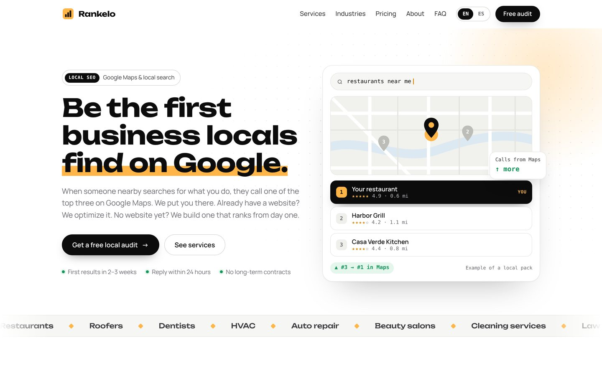
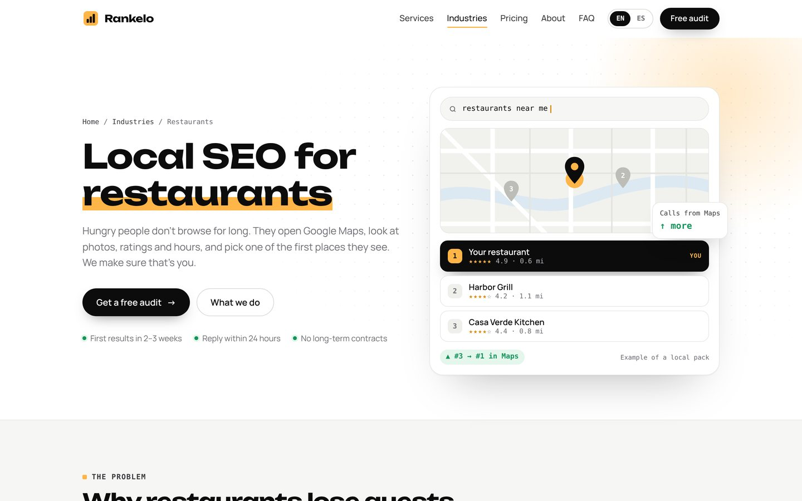
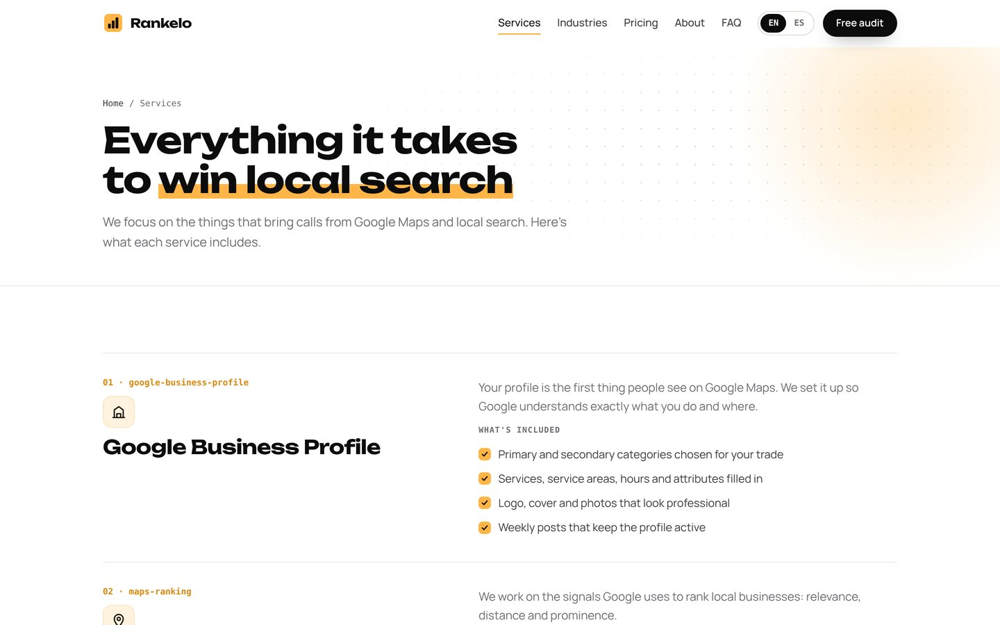
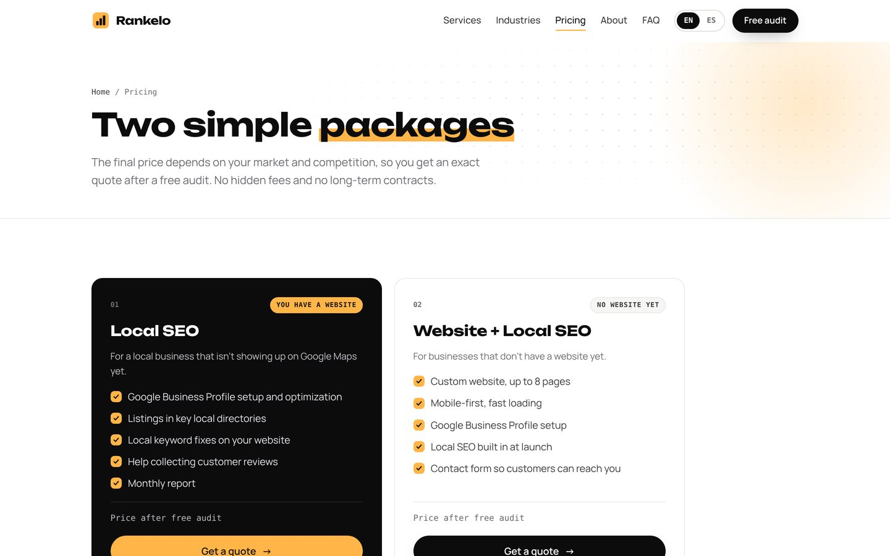
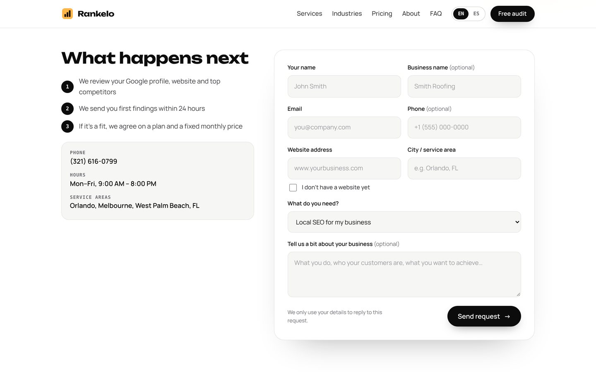
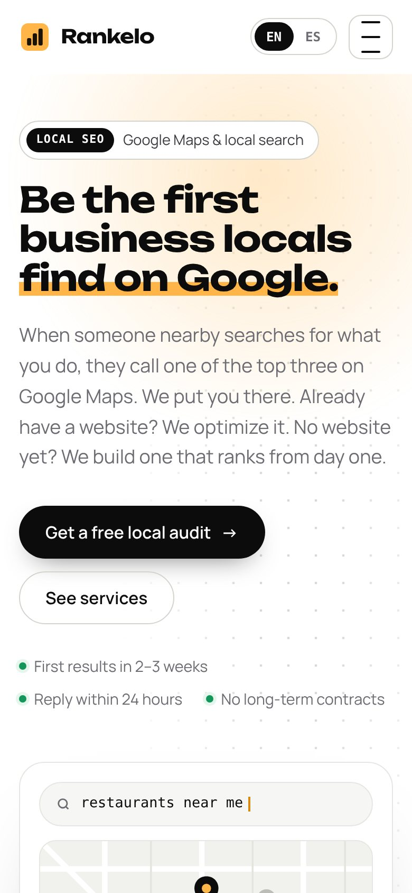
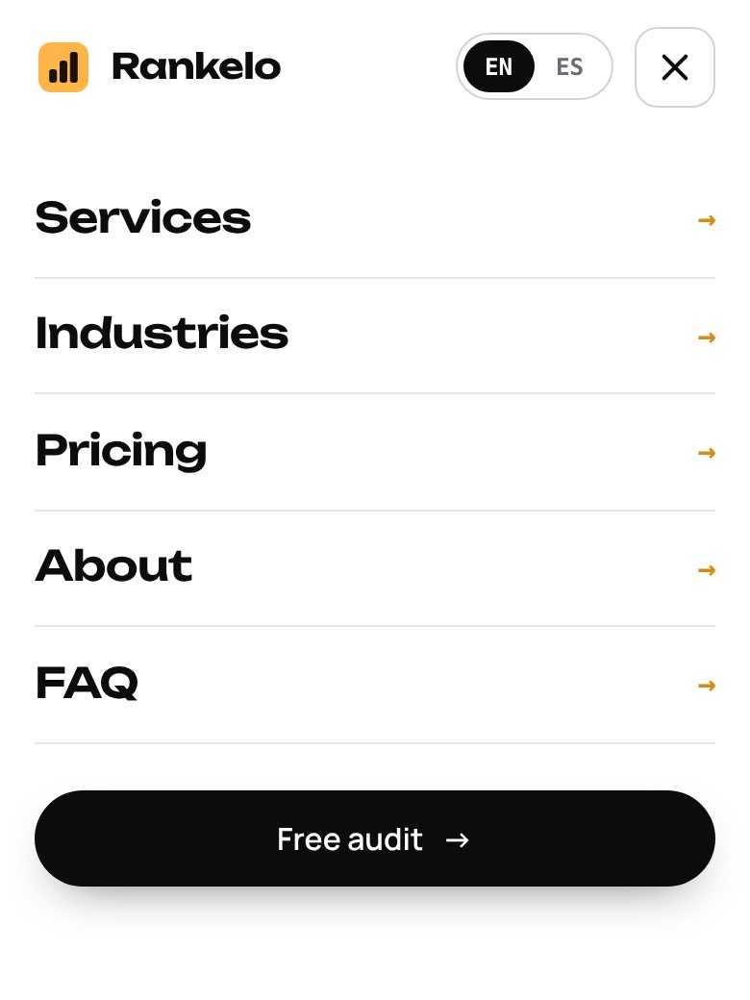

# Rankelo — website

The marketing website for **[Rankelo](https://rankelo.org)**, a local SEO and web design studio in Florida.
A fast static site built to rank on Google and turn visitors into requests.

**Live:** [rankelo.org](https://rankelo.org)



## Highlights

- **Full multi-page site.** Home, Services, Industries, Pricing, About, FAQ, Contact and four industry
  landing pages (restaurants, roofers, dentists, HVAC).
- **Technical SEO built in.** Unique titles and descriptions, canonical URLs, an XML sitemap, Open Graph / social preview images, and 301 redirects for old URLs.
- **Structured data (schema.org JSON-LD).** `ProfessionalService` with phone, hours and service areas,
  plus `WebSite`, `WebPage`, `BreadcrumbList`, `FAQPage` and `Service` on industry pages.
- **Working lead form.** Validation, spam honeypot and submissions sent to email through Web3Forms,
  with the source page and industry attached to each request.
- **Interaction design.** An animated Google Maps "local pack" in the hero that types a search and moves the
  client to #1, scroll-driven reveals, a marker-highlight on headings, magnetic buttons and card spotlights.
  All motion respects `prefers-reduced-motion`.
- **Fast and dependency-free.** Plain HTML, one CSS file and one small JS file. No framework, no build-time
  JavaScript tooling, no tracking scripts.
- **Responsive and accessible.** Mobile menu, keyboard focus states, skip link, semantic headings and labels.

## Screenshots

| Industry page | Services |
|---|---|
|  |  |
| **Pricing** | **Contact** |
|  |  |

| Mobile | Mobile menu |
|---|---|
|  |  |

Full homepage: [screenshots/desktop-home-full.jpg](screenshots/desktop-home-full.jpg)

## How it's built

The site is generated by a small Python script. All copy lives in data files, so adding a page
means adding content, not editing HTML.

```
src/
  build.py        # generates every page, sitemap, redirects, icons and social images
  content.py      # site copy: navigation, services, pricing, FAQ, page text
  niches_v2.py    # industry landing pages
  assets/
    site.css      # design system: tokens, layout, components, animation
    site.js       # mobile menu, hero animation, pointer effects, lead form
fonts/            # Unbounded + Manrope (SIL Open Font License) for the social preview images
screenshots/
```

### Build

Requires Python 3.10+ and Pillow.

```bash
pip install pillow
python3 src/build.py https://rankelo.org YOUR_WEB3FORMS_KEY
```

The output goes to `dist/` (plus `rankelo-site.zip`). Without a form key the site builds in preview mode:
the form validates but doesn't send.

### Deploy

Hosted on **Cloudflare Pages** with the custom domain `rankelo.org`. `dist/_redirects` handles old URLs.
Upload `rankelo-site.zip` as a new production deployment.

## Stack

HTML · CSS · vanilla JavaScript · Python (site generator, Pillow for images) · Cloudflare Pages ·
Web3Forms · Google Search Console

## Typography

[Unbounded](https://fonts.google.com/specimen/Unbounded) for headings,
[Manrope](https://fonts.google.com/specimen/Manrope) for text and
[JetBrains Mono](https://fonts.google.com/specimen/JetBrains+Mono) for labels, all served by Google Fonts.
The bundled font files are licensed under the SIL Open Font License (see `fonts/`).

---

© Rankelo. The code is shared as a portfolio piece. The Rankelo name, logo and website copy belong to Rankelo.
